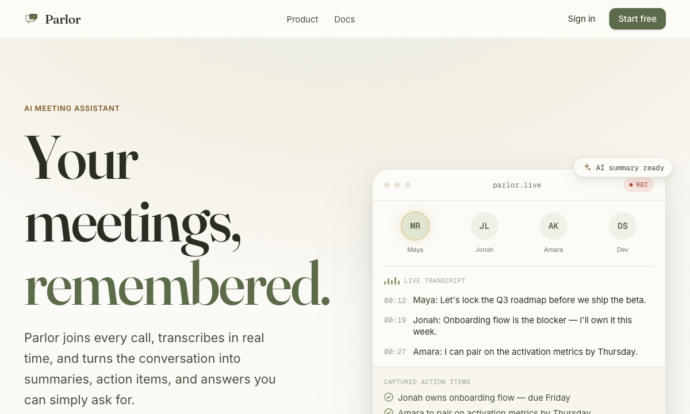
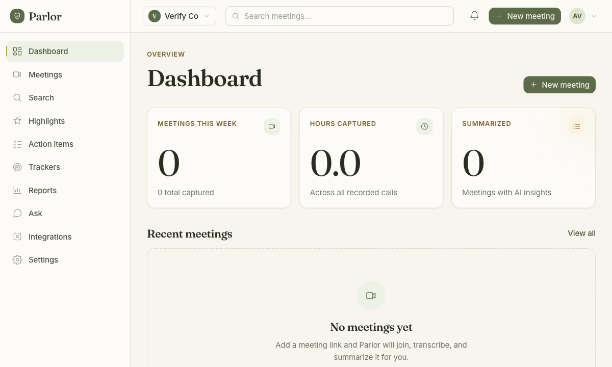
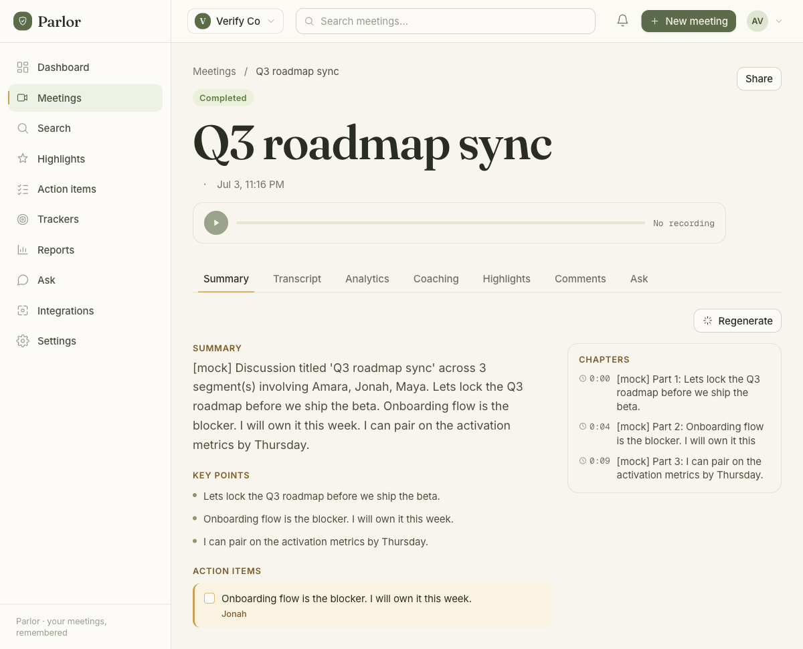
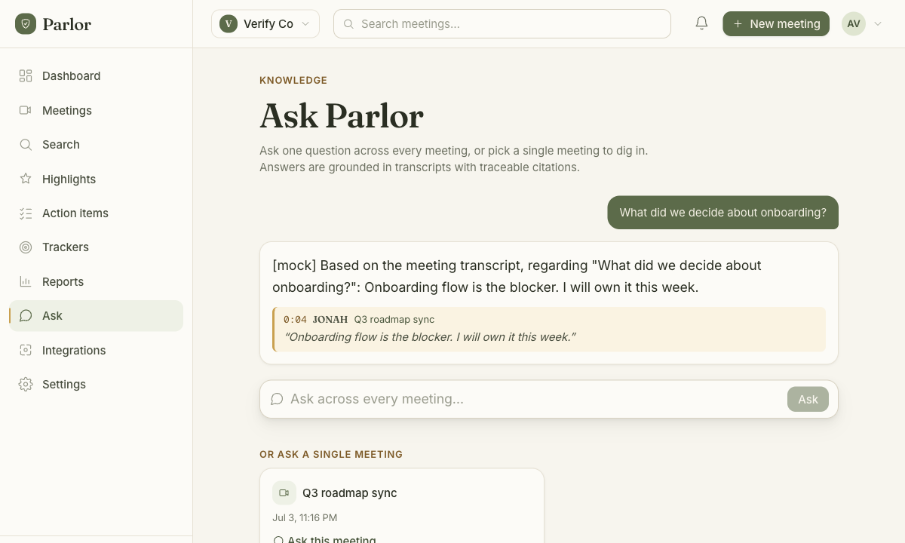

<p align="center">
  
</p>

<h1 align="center">Parlor</h1>

<p align="center">
  <a href="./LICENSE"></a>
  <a href="https://github.com/HarshitKmr10/parlor/actions/workflows/ci.yml"></a>
</p>

**Your meetings never leave your machine — unless you want them to.**

Parlor is a self-hosted AI meeting notetaker. Its default capture mode is
**botless**: instead of a bot joining your Zoom/Meet/Teams call as a visible,
recording third participant, Parlor's desktop client captures your machine's
own meeting audio locally and turns it into a transcript, summary, action
items, and a chat-with-your-meeting Q&A — without anything joining the call on
your behalf. (A server-side bot-join mode also exists, for when you'd rather
dispatch a bot into a call than run local capture — see
[`backend/docs/BOT-RUNTIME.md`](backend/docs/BOT-RUNTIME.md).)

The other thing this project leads with: a genuine **zero-API-key mock mode**.
Clone it, run one command, and the whole stack — auth, meetings, AI summaries,
embeddings, chat — comes up and works end to end with deterministic
placeholder output before you have touched a single LLM provider key. Add a
key later to switch from mock to live models; nothing else about the setup
changes.

> [!NOTE]
> Parlor is self-hosted and community-supported on a best-effort basis —
> there's no formal SLA or paid support tier attached to this repository.
> See [`SECURITY.md`](./SECURITY.md) for how to report a vulnerability and
> [`CONTRIBUTING.md`](./CONTRIBUTING.md) for how pull requests get reviewed.
>
> Parlor is built and open-sourced by [FuturePath AI](https://github.com/FuturePathAI),
> which also builds a separate, closed-source product for enterprises. That
> product is not part of this repository, shares no code with it beyond what
> you see here, and nothing in Parlor requires it — see
> ["What's different from FuturePath AI's other products?"](#whats-different-from-futurepath-ais-other-products)
> below.

<p align="center">
  
</p>

## Try it in 2 minutes

Requires Docker Engine + Compose v2 (`docker compose version`). Nothing else —
no API key, no account, no cloud service.

```bash
git clone https://github.com/HarshitKmr10/parlor.git
cd parlor
cp .env.example .env      # safe local defaults, already in mock mode
make up-api                # backend + ai-service + web + postgres
```

Wait for `make up-api` to report the stack healthy (usually well under a
minute after images are built), then open **http://localhost:3001** and sign
up — there's no separate admin CLI or setup wizard, the first account you
create in the app is your workspace owner. This exact path was verified end
to end, fresh, timed at 68 seconds from `docker compose up --build` to all
services healthy: sign up via the UI → `POST /api/v1/meetings/botless` (the
botless creation path — the UI's "New meeting" button expects a real
Zoom/Meet/Teams link and dispatches a bot, which needs the heavier
`Dockerfile.botruntime` image, not this fast path) →
`POST /api/v1/meetings/{id}/transcript` → `POST /api/v1/meetings/{id}/complete`
→ a mock summary with real key-point/action-item extraction appeared in
under 2 seconds → `POST /api/v1/ask` answered a question about it with a
citation back to the exact transcript segment. All of it with `AI_MODE=mock`
and no keys anywhere in `.env`.

<p align="center">
  
  
</p>
<p align="center">
  
</p>

`make up` (instead of `make up-api`) additionally brings up the real
Playwright/Chromium bot-join worker in its own container, mirroring
production — see [Make targets](#make-targets) below. The first build of that
image is large and slow (Node + Chromium + a local Whisper cache); `make
up-api` is the fast path for trying the product or iterating on it.

## Features

- **Botless local capture** (`desktop-capture/`) — system-audio transcription
  with no bot joining the call, Granola-style. macOS-first today.
- **Zero-API-key mock mode** — the full stack (auth, meetings, summaries,
  embeddings, chat) runs and is demoable with `AI_MODE=mock` and no LLM keys.
- **AI summaries, action items, and chapters** per meeting, plus **chat with a
  meeting** (and across all your meetings) with cited, timestamped answers —
  backed by pgvector RAG.
- **Keyless local transcription** available via a bundled tiny Whisper model
  — no cloud STT account required for the audio-capture path.
- **Optional bot-join capture** for Zoom (SDK), Google Meet, and Microsoft
  Teams, if you'd rather dispatch a bot than run local capture.
- **MCP server** (`mcp/`) exposing your meeting knowledge base to Claude
  Desktop, Claude Code, ChatGPT, and other MCP clients.
- **Self-hosted only.** No hosted trial, no managed tier, no telemetry phoning
  home — the product is the Docker Compose file (or the Helm chart under
  `deploy/helm/parlor/` for Kubernetes).

## What's included

Parlor is a self-hostable meeting-intelligence platform, with a notetaker at
its core. The botless, privacy-first capture described above is the lead
feature and the reason to reach for this project — but the rest of the stack
that ships alongside it is substantial enough to be worth listing honestly
rather than pretending it isn't there:

- **Meeting capture, transcription, and AI summaries** — the core notetaker:
  botless local capture or optional bot-join, transcripts, summaries, action
  items, chapters, and cross-meeting RAG chat (see Features above).
- **Calendar integrations** — Google Calendar and Microsoft Calendar OAuth,
  for scheduling context around meetings.
- **CRM and recap delivery** — push meeting recaps and action items to Slack,
  Notion, HubSpot, and Salesforce (`backend/src/integrations/crm_providers.py`).
- **Outbound webhooks** — generic HMAC-signed webhooks with retry, so any
  external system can subscribe to meeting events.
- **Optional enterprise SSO** — generic OIDC single sign-on
  (`backend/src/sso/`), for teams that already run an identity provider.
- **Audit logging and retention controls** — an audit trail for
  security-sensitive actions, plus configurable data retention (with a
  tombstone/recovery window) and legal-hold export, for organizations with
  compliance requirements.
- **Coaching scorecards** — call-coaching metrics derived from meeting
  transcripts (`backend/src/coaching/`).
- **MCP server** — exposing your meeting knowledge base to Claude Desktop,
  Claude Code, ChatGPT, and other MCP clients (also listed above).

None of the above is required to run Parlor as "just" a notetaker — the SSO,
CRM, and coaching pieces are all optional and inert until configured. They
exist because this project grew out of a broader meeting-intelligence
codebase, and rather than strip them out we're leaving them in and
documenting them, since removing working, self-hostable code would be a
worse outcome than being upfront about what's here. There is no billing or
payment concept anywhere in this repository — it was deliberately removed
for the open-source release.

## What's different from FuturePath AI's other products?

> **A note on scope, not marketing:** FuturePath AI, the team behind Parlor,
> also builds a separate, closed-source product for enterprises. The section
> below is intentionally conservative about what it says regarding that
> product — treat it as a placeholder for a maintainer to refine, not as
> settled positioning copy.

- **Parlor is fully open-source.** There's no "open core" split — everything
  in this repository, including bot-join capture, RAG chat, and webhooks, is
  available under [FSL-1.1-Apache-2.0](./LICENSE) with no license key and no
  gated "enterprise edition" of Parlor itself.
- **Parlor is self-hosted only.** There is no hosted or managed version of
  Parlor, and none is planned as part of this project — see the callout near
  the top of this README.
- **Parlor's scope stops at the meeting layer.** It captures, transcribes,
  summarizes, and lets you chat with your own meetings (per-meeting and
  across your workspace), and exposes that over webhooks and an MCP server.
  It does not include FuturePath AI's other, separately built and
  closed-source product line — that product is not part of this repository
  and this README intentionally does not describe it further.

## Built with

| Layer | Stack |
|---|---|
| Backend API | Python 3.12, [FastAPI](https://fastapi.tiangolo.com/) ^0.120, Pydantic v2, `asyncpg`, Poetry |
| AI service | Python 3.11+, FastAPI, Pydantic v2, Anthropic + OpenAI SDKs (optional), `asyncpg` |
| Web | [Next.js](https://nextjs.org/) 16 (App Router), React 19, TypeScript 5, Tailwind CSS 4, SWR |
| Database | PostgreSQL 16 + [pgvector](https://github.com/pgvector/pgvector) (`pgvector/pgvector:pg16`), one shared instance for both API and vector search |
| Bot runtime (optional) | Node.js + Playwright/Chromium, Xvfb, PulseAudio, ffmpeg |
| Local/offline transcription | `@xenova/transformers` running a bundled tiny Whisper model — no cloud STT account required |
| Testing | pytest (backend, ai-service), Playwright (`web/e2e`) |
| Deployment | Docker Compose (dev/self-host), Helm chart under `deploy/helm/parlor/` (Kubernetes) |
| MCP integration | `mcp/` — a stdio MCP server (TypeScript) exposing `search_meetings` / `get_meeting` / `ask_meetings` |

## Architecture

```
                                  browser
                                     │
                                     ▼  http://localhost:${WEB_PORT}
                          ┌──────────────────────┐
                          │  web  (Next.js :3000) │   cookie auth, full UI
                          └──────────┬───────────┘
                                     │  http://localhost:${API_PORT}  (browser → backend)
                                     ▼
                          ┌──────────────────────┐   POST /configure (HTTP)   ┌─────────────────────────────┐
                          │ backend (FastAPI :8000) │ ─────────────────────────▶│ meeting-worker (sidecar :9000)│
                          │   RUNTIME_MODE=compose   │                          │  spawns the REAL bot:         │
                          │   /api/v1 auth, meetings │ ◀───────────────────────  │  Node + Playwright Chromium   │
                          └─────┬───────────┬──────┘  /internal/sessions/ended  │  on Xvfb :99  (separate cntr) │
              AI_SERVICE_URL    │           │   DATABASE_URL                     └──────────────┬──────────────┘
        http://ai-service:8100  │           │   postgres:5432                            DATABASE_URL │ (bot writes
                                ▼           ▼                                    postgres:5432 ◀──────┘  transcripts)
              ┌──────────────────────┐   ┌──────────────────────────────┐
              │ ai-service (:8100)    │──▶│ postgres (pgvector :5432)     │
              │ summarize/embed/chat  │   │ ONE shared DB:                │
              │ mock mode w/o keys    │   │  • backend product/auth/mtgs  │
              └──────────────────────┘   │  • ai-service meeting_embeddings│
                                         └──────────────────────────────┘
```

`make up` runs the **separated** stack (mirroring prod): the API and the bot
live in **different containers**. The API dispatches each meeting to the
`meeting-worker` container's sidecar over HTTP (`POST /configure`); the worker
spawns the real Playwright/Chromium bot. See
[backend/docs/BOT-RUNTIME.md](backend/docs/BOT-RUNTIME.md) for the three
dispatch modes (standalone in-process, compose separate-worker, k8s warm-pool).

- **Single shared Postgres** (`pgvector/pgvector:pg16`) backs both services.
  Backend schema is applied from `backend/db/*.sql` on first boot
  (`bootstrap.sql` → `0002_product_auth.sql` → `0003_calendar_integrations.sql`).
  The ai-service creates its `meeting_embeddings` table on startup.
- **Inter-service URLs use Docker DNS** (`postgres`, `ai-service`, `backend`).
  **Host ports** (configurable in `.env`) are for the browser / local dev.
- The stack runs **with no LLM keys**: the ai-service is in **mock mode**, so
  summaries/embeddings/chat return deterministic structured data.

The `mcp/` directory (stdio MCP server) is intentionally **not** part of this
runtime stack.

## Prerequisites

- Docker Engine + Compose v2 (`docker compose version`)
- `bash`, `curl`, `jq` (for the smoke test)

## Quick start (full stack, with the real bot-join worker)

```bash
cp .env.example .env     # safe local defaults; or `make up` creates it for you
make up                  # build + start the SEPARATED stack (API + meeting-worker bot)
make ps                  # wait until all services are "healthy"
make logs-worker         # follow the meeting-worker (bot) container logs
make smoke               # end-to-end cross-service smoke test
make down                # stop everything (keeps the DB volume)

# Fast API-only iteration (no bot container; in-process standalone degrade):
make up-api
```

> The first `make up` build is large/slow — the `meeting-worker` image carries
> Node + Playwright Chromium + node_modules + Xvfb/pulse/ffmpeg + a local whisper
> cache. Use `make up-api` for quick backend/product iteration or for just
> trying the product.

### Recording consent

The bot-join path (this section) dispatches a bot into a real call and
records it — audio, video where applicable, and the resulting transcript.
Recording-consent laws vary by jurisdiction: many US states and several
countries require **all-party consent**, not just the host's. This is a live
legal question for meeting-bot products generally (see, e.g., *Brewer v.
Otter.ai*, filed 2025, alleging wiretap-law violations from a meeting bot
recording non-consenting participants).

This is not legal advice, and Parlor cannot know or enforce what your
jurisdiction requires. If you enable bot-join, **you are responsible for
complying with your applicable recording-consent laws** before dispatching
the bot into a meeting with other people — typically by disclosing the
recording and getting participants' consent up front (Parlor's bot joins
under a visible display name for exactly this reason). The botless
`desktop-capture/` path carries the same obligation whenever it captures
audio from a call with other participants, not just this one.

### URLs (defaults; override in `.env`)

| Service        | URL                              | Notes                              |
|----------------|----------------------------------|------------------------------------|
| web            | http://localhost:3001            | login at `/login`                  |
| backend        | http://localhost:8001            | `/api/v1`, `/health`, `/ready`     |
| meeting-worker | http://localhost:9000/           | sidecar control plane (the bot)    |
| ai-service     | http://localhost:8101/health     | internal; rarely hit directly      |
| postgres       | localhost:5434                    | user/db `meeting`                  |

> **Ports are configurable.** Defaults are `WEB_PORT=3001`, `API_PORT=8001`,
> `AI_PORT=8101`, `POSTGRES_PORT=5434` — chosen to avoid the commonly-occupied
> 3000 / 8000 / 8100 / 5432. Change them in `.env` if they clash on your host.
> Inter-service traffic uses Docker DNS and is unaffected by host-port changes.

### API docs and developer tools

After you've signed up in the web app, visit **`/developers`**
(`http://localhost:3001/developers` with default ports) for copy-pasteable
`curl` quickstarts (auth, listing meetings, cross-meeting Ask, webhooks,
botless VTT capture) and links to the backend's live API docs:

- Swagger UI — `${API_URL}/docs`
- ReDoc — `${API_URL}/redoc`
- Raw OpenAPI schema — `${API_URL}/openapi.json`

Workspace API keys (for MCP clients or your own scripts) are created from
Settings inside the app (`POST /api/v1/workspaces/{id}/api-keys`).

## Going from mock → live LLMs

The ai-service auto-detects mock vs. live. To use real models:

1. Put at least one key in `.env`:
   ```bash
   ANTHROPIC_API_KEY=sk-ant-...
   # and/or
   OPENAI_API_KEY=sk-...
   AI_MODE=live           # or leave blank to auto-detect when a key is present
   ```
2. `make down && make up` (rebuild not required; the var is read at runtime).

Provider order is controlled by `AI_PROVIDER_ORDER` (default `anthropic,openai`);
the first provider that succeeds wins, falling through on error. No code or
compose changes are needed — only `.env`.

## End-to-end smoke test

`scripts/smoke_e2e.sh` (run via `make smoke`) proves the full cross-service flow
against the running stack:

1. `POST /api/v1/auth/signup` → captures `accessToken` + `workspaceId`.
2. `POST /api/v1/meetings` (a Google Meet URL) → captures `meetingId`.
3. **Seeds a transcript** into `meeting_joiner.transcript` via
   `docker compose exec postgres psql` — a **test shim** standing in for a real
   bot join writing captured segments.
4. `POST /api/v1/meetings/{id}/summarize` → asserts `MeetingInsights`
   (summary / keyPoints / actionItems / chapters). Exercises
   **backend → ai-service `/summarize`** (mock).
5. **Seeds embeddings** by calling the ai-service `/embed` directly with the
   same segments → writes the `meeting_embeddings` pgvector table. (Another test
   shim: the capture pipeline would embed during a live meeting.)
6. `POST /api/v1/meetings/{id}/ask` → asserts `{ answer, citations[] }`.
   Exercises **backend → ai-service `/chat` → pgvector retrieval** end-to-end.

It asserts each step's HTTP status + key fields and exits non-zero on any
failure with a PASS/FAIL summary.

## Make targets

| Target             | Action                                                                  |
|--------------------|-------------------------------------------------------------------------|
| `make up`          | build + start the SEPARATED stack (API + meeting-worker bot); creates `.env` if absent |
| `make up-bots`     | alias for `make up`                                                     |
| `make up-api`      | API-only fast iteration (no worker; standalone in-process degrade)      |
| `make down`        | stop + remove containers (keeps the DB volume)                          |
| `make reset`       | `down -v` — also drop the DB volume (fresh schema next up)              |
| `make logs`        | follow logs for all services                                            |
| `make logs-worker` | follow ONLY the meeting-worker (bot) container                          |
| `make smoke`       | run `scripts/smoke_e2e.sh`                                              |
| `make ps`          | service status / health                                                 |
| `make psql`        | open a psql shell on the shared Postgres                                |
| `make build`       | build all images (separated stack)                                      |

## Configuration

All configuration is via `.env` (see `.env.example` for every variable, with
documentation). No secrets are baked into images or compose files. Optional
integrations (Google/Microsoft calendar OAuth, Slack, SMTP) are documented in
`.env.example` and are **not** required for the stack to boot.

## Backup & operations

All persistent data — meetings, transcripts, summaries, embeddings, auth —
lives in the `parlor_pgdata` Docker volume backing the shared Postgres.
See [`docs/OPERATIONS.md`](docs/OPERATIONS.md) for `pg_dump`/`pg_restore`
backup and restore steps, and approximate RAM/CPU/disk sizing for the
API-only path (`make up-api`) vs. the full separated-worker path with the
real bot (`make up`).

## Known limitations

- **Web SSR → backend in Docker.** The web app resolves its backend base URL
  from a single public var (`NEXT_PUBLIC_API_URL`, default
  `http://localhost:${API_PORT}`). That value is correct for the **browser**.
  Server-side rendering inside the web container also uses it, so SSR fetches
  resolve to the web container's own `localhost`. Pages that fetch on the
  browser (login, signup, the auth route handlers proxied through Next) and the
  smoke test (which talks to the backend directly) are unaffected. Wiring SSR to
  the internal DNS name (`http://backend:8000`) would require a small,
  backward-compatible code change to add a server-only base-URL override; it was
  intentionally left out to avoid modifying service source for this stack-up.
- The bot-join / live-capture path is not exercised by the smoke test (it needs
  the heavier worker image with Chromium + Zoom SDK). Transcript + embeddings
  are seeded as documented test shims so the AI pipeline is provable offline.

## License

Parlor is licensed under the **[Functional Source License 1.1, Apache 2.0
Future License](./LICENSE)** (FSL-1.1-Apache-2.0) — the same license family
Sentry uses. In short: you can use, self-host, modify, and redistribute this
software for almost any purpose, including running it for your own team or
building on it — the one thing the license doesn't permit is re-offering it
(or a substitute for it) to third parties as a competing hosted or managed
service. Two years after each version is published, that version
automatically relicenses to Apache 2.0, with no strings attached. See
[`LICENSE`](./LICENSE) for the full text.

## Contributing

See [`CONTRIBUTING.md`](./CONTRIBUTING.md) for how to run the tests and submit
a pull request (DCO sign-off required, no CLA), and the
[`CODE_OF_CONDUCT.md`](./CODE_OF_CONDUCT.md) for community expectations.
Security issues should be reported privately — see [`SECURITY.md`](./SECURITY.md).

---

<sub>Maintained by the Parlor team.</sub>
